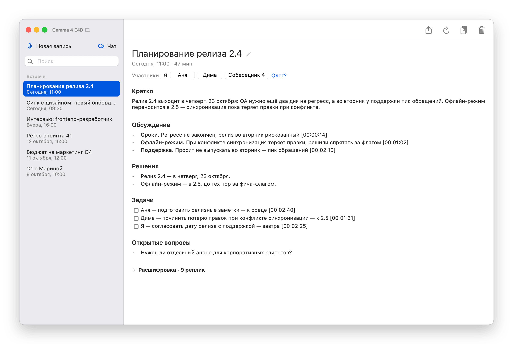
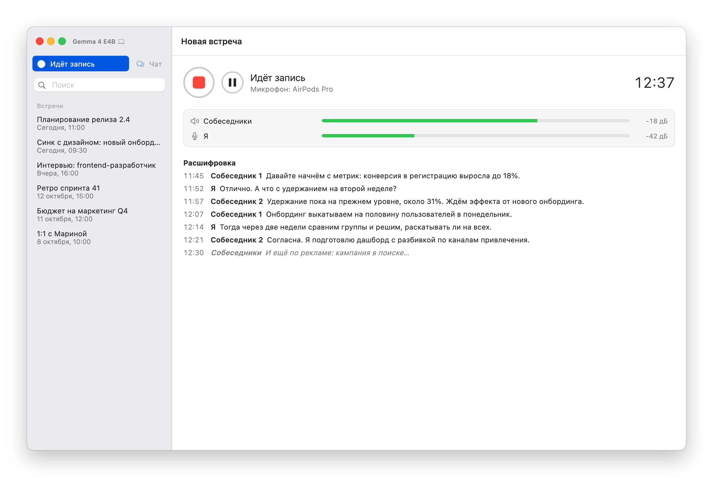
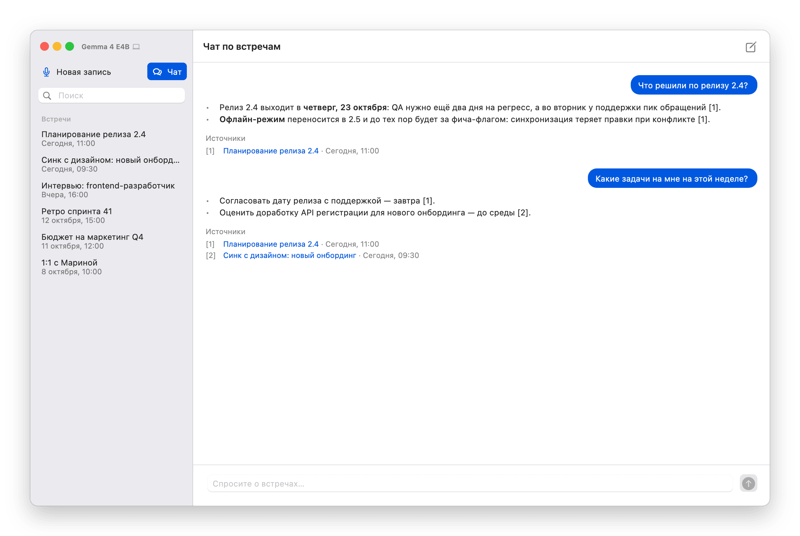
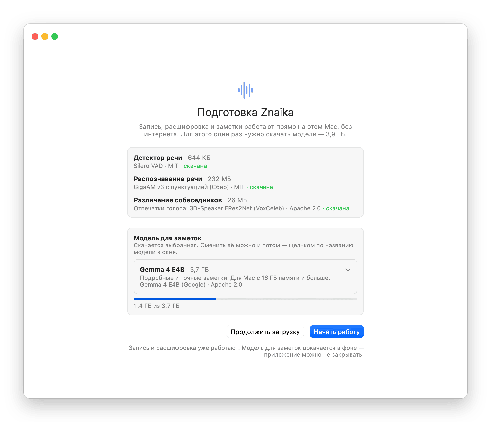

# Znaika

Знайка слушает ваши созвоны и пишет по ним заметки: расшифровка русской речи на лету,
собеседники по голосу, решения и задачи, чат по прошедшим встречам. Всё работает прямо
на Mac — без облака, аккаунтов и подписок; звук и тексты никуда не отправляются.

<picture>
  <source media="(prefers-color-scheme: dark)" srcset="docs/screenshots/meeting-dark.png">
  
</picture>

## Возможности

- **Запись любого созвона.** Zoom, Meet, Телемост, Teams — что угодно: Знайка пишет системный
  звук (собеседников) и ваш микрофон раздельно, ничего не подключая к самому созвону.
- **Расшифровка на лету.** Реплика появляется через доли секунды после того, как её
  договорили; пунктуация расставляется сама.
- **Собеседники по голосу.** «Собеседник 1», «Собеседник 2»… — имя даётся в один щелчок,
  а подсказки («Олег?») берутся из обращений в разговоре.
- **Заметки после встречи.** Кратко, обсуждение, решения, задачи с ответственными и сроками,
  открытые вопросы — со ссылками на моменты записи. Заметки можно пересоздать, например
  после того как собеседники получили имена.
- **Чат по встречам.** «Что решили по релизу?», «Какие задачи на мне?» — ответ по заметкам
  и расшифровкам, со ссылками на встречи.
- **Поиск** по заголовкам, заметкам и расшифровкам; экспорт в Markdown.
- **Пауза и автоостановка** после 10 минут тишины; обработка идёт в фоне — следующую
  встречу можно записывать сразу.

<picture>
  <source media="(prefers-color-scheme: dark)" srcset="docs/screenshots/recording-dark.png">
  
</picture>

<picture>
  <source media="(prefers-color-scheme: dark)" srcset="docs/screenshots/chat-dark.png">
  
</picture>


## Требования

- Mac на Apple Silicon (M1 и новее), macOS 14.2 или новее.
- 16 ГБ памяти для основной модели заметок (Gemma 4 E4B); на Mac с 8 ГБ — облегчённая
  Gemma 4 E2B.
- ~5 ГБ на диске под модели; интернет — только чтобы один раз их скачать.
- Язык — **только русский**: модели подобраны и проверены на русской речи.

## Установка

Готовых сборок пока нет — Знайка собирается из исходников.

1. Установите [Flutter](https://docs.flutter.dev/get-started/install/macos) 3.47+ и Xcode.
2. Установите Git LFS — в нём хранится библиотека LiteRT-LM (66 МБ):
   ```bash
   brew install git-lfs && git lfs install
   ```
3. Склонируйте и соберите:
   ```bash
   git clone https://github.com/borisrozumnuk/znaika.git
   cd znaika
   make run
   ```
   Если клонировали без Git LFS, сборка упадёт на `libCLiteRTLM_mac.dylib` — выполните
   `git lfs pull`.
4. **Подпись (по желанию).** По умолчанию приложение подписывается локально, без команды
   разработчика, — сборка работает сразу. Но тогда macOS может заново спрашивать разрешения
   после каждой пересборки. Чтобы этого не было, подпишите своей командой (подойдёт
   бесплатный Apple ID, добавленный в Xcode → Settings → Accounts): создайте
   `macos/Runner/Configs/Signing.local.xcconfig` (он не попадает в git):
   ```
   CODE_SIGN_STYLE = Manual
   CODE_SIGN_IDENTITY = Apple Development
   DEVELOPMENT_TEAM = <ID вашей команды>
   ```
   ID команды (10 символов) — поле `OU` сертификата:
   `security find-certificate -c "Apple Development" -p | openssl x509 -noout -subject`.

При первом запуске Знайка скачает модели (~4 ГБ, экран «Подготовка Znaika»), а при первой
записи macOS спросит разрешение на микрофон и на запись системного звука.

<picture>
  <source media="(prefers-color-scheme: dark)" srcset="docs/screenshots/setup-dark.png">
  
</picture>

## Модели

Все модели встроенные: скачиваются один раз в
`~/Library/Application Support/local.experiments.znaika/models/` с проверкой SHA-256
и работают локально.

| Зачем | Модель | Размер | Лицензия |
|---|---|---|---|
| Детектор речи | Silero VAD | 644 КБ | MIT |
| Распознавание речи | GigaAM v3 с пунктуацией (Сбер) | 232 МБ | MIT |
| Различение собеседников | 3D-Speaker ERes2Net (VoxCeleb) | 26 МБ | Apache 2.0 |
| Заметки и чат | Gemma 4 E4B (Google) — по умолчанию на Mac с 16 ГБ | 3,7 ГБ | Apache 2.0 |
| | Gemma 4 E2B (Google) — легче, для Mac с 8 ГБ | 2,6 ГБ | Apache 2.0 |
| | Qwen3 4B Instruct 2507, 4 бита (Alibaba) | 2,7 ГБ | Apache 2.0 |

Модель для заметок выбирается на экране первого запуска или позже — щелчком по её названию
у кнопок окна.

## Как это устроено

- **Захват звука** — `packages/meet_capture`, Swift-плагин на Core Audio: системный звук
  через Process Tap, микрофон через IOProc, оба канала в 16 кГц. Устройства системы не
  переключаются.
- **Расшифровка** — `sherpa-onnx`: Silero VAD режет поток на фразы, каждая фраза сразу
  уходит в GigaAM v3 (фоновый изолят). Эхо собеседников в микрофоне отбрасывается,
  голоса различаются по отпечаткам ERes2Net.
- **Заметки и чат** — `packages/litert_lm`, собственная Dart FFI-обёртка над C API
  [LiteRT-LM](https://github.com/google-ai-edge/LiteRT-LM) v0.17.1; модель считается на GPU,
  при перегреве видеокарты — на процессоре. Длинные встречи обрабатываются частями;
  вопросы чата проходят между частями заметок.
- **Хранение** — папка на встречу (`transcript.md`, `summary.md`, `meeting.json`) и индекс
  SQLite с полнотекстовым поиском FTS5. Звук после обработки удаляется.
- **Интерфейс** — Flutter + [`macos_ui`](https://pub.dev/packages/macos_ui): системная тема,
  акцентный цвет и отступы macOS.

Производительность на MacBook Air M3 (16 ГБ): реплика — через ~0,6 с после конца фразы;
ответ в чате — ~10 с; заметки по часовой встрече — до получаса (видеокарта Air без
вентилятора перегревается, и часть работы идёт на процессоре).

## Разработка

```bash
make              # релизная сборка
make run          # собрать и открыть
make test         # анализатор и тесты
make zip          # сборка, проверка подписи и zip на рабочий стол — перенести на другой Mac
make screenshots  # перерисовать и сжать скриншоты для README (сжатие — brew install pngquant)
make setup-screen # экран первого запуска, даже если модели уже скачаны
make clean
```

После правки `lib/database.dart` — `dart run build_runner build` (`analyzer` закреплён
на 14.4.0: с 14.5.0 `build_runner` 2.16.1 не собирается).

**Самопроверки без интерфейса** — переменные окружения при запуске
`build/macos/Build/Products/Release/Znaika.app/Contents/MacOS/Znaika`:

| Переменная | Что делает |
|---|---|
| `ZNAIKA_SELFTEST=10` | записать 10 с, расшифровать, вывести (`ZNAIKA_FULL=1` — ещё заметки и заголовок) |
| `ZNAIKA_TRANSCRIBE=<папка>` | расшифровать готовую запись (`mic.wav` / `system.wav`) |
| `ZNAIKA_SUMMARIZE=<папка>` | расшифровать и написать заметки |
| `ZNAIKA_RESUMMARIZE=<папка>` | заметки по готовому `transcript.md` |
| `ZNAIKA_IMPORT=<wav 16 кГц>` | готовая запись → встреча (`ZNAIKA_IMPORT_AT=<ISO>` — время начала) |
| `ZNAIKA_ASK='вопрос\|уточнение'` | чат по встречам: вопросы через `\|` |
| `ZNAIKA_DOWNLOAD=60` | проверить модели, качать 60 с, вывести прогресс |

Звук из видео для `ZNAIKA_IMPORT`: `ffmpeg -i x.mp4 -vn -ac 1 -ar 16000 -c:a pcm_s16le x.wav`.

Журнал приложения — `~/Library/Logs/Znaika/znaika.log`.

## Ограничения

- Только русский язык и только macOS на Apple Silicon.
- Чат ищет встречи по словам вопроса: перефразировки и синонимы («деньги» вместо «бюджет»)
  не находит — тогда отвечает по последним встречам.
- Имя собеседника сначала подставляется в заметки без склонения; склонение и род исправляет
  «Пересоздать заметки».
- Модель иногда принимает вопрос за поручение или не подписывает задачу именем.
- Сборка без нотаризации: на другом Mac первый запуск нужно разрешить в «Системные
  настройки → Конфиденциальность и безопасность».

## Лицензия

[PolyForm Noncommercial 1.0.0](LICENSE.md): смотреть, собирать, изменять и использовать
Znaika можно в личных, учебных, исследовательских и других некоммерческих целях.
Коммерческое использование — только с разрешения автора; напишите, если оно нужно.

Сторонние компоненты (библиотека LiteRT-LM, модели, пакеты Flutter) — под своими
лицензиями, см. [THIRD_PARTY_NOTICES.md](THIRD_PARTY_NOTICES.md).

## Автор

[Boris Rozumniuk](https://www.linkedin.com/in/rozumnyuk/)
